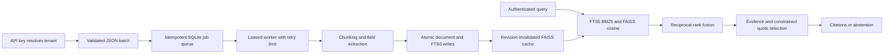

# Enterprise RAG Document Pipeline

**Durable document ingestion, transparent field extraction, tenant-scoped hybrid
retrieval and source-grounded Q&A through FastAPI.**


Document systems need repeatable ingestion, traceable answers and isolation between
customers. This reference implementation combines a persistent SQLite job queue,
transactional document upserts, FTS5 ranking, FAISS cosine search and reciprocal-rank
fusion. It offers a realistic engineering foundation with explicit operating limits.

## Architecture



- **Persistence:** SQLite WAL with parameterized queries and atomic batch writes.
- **Queue:** durable jobs, 60-second leases, stale-worker fencing and three-attempt limit.
- **Idempotency:** tenant-scoped keys; different payload under the same key returns 409.
- **Extraction:** auditable regular expressions for dates, currency amounts and reference IDs.
- **Retrieval:** selectable lexical, vector or hybrid mode; RRF constant 60; up to 50 candidates per channel.
- **Citations:** content-derived chunk IDs include tenant, document, content digest and chunk ordinal.
- **Isolation:** tenant comes from the authenticated API key, never a caller-controlled tenant header.

## API

| Method | Endpoint | Behavior |
|---|---|---|
| POST | `/v1/ingest` | Submit up to 50 documents, 202; requires `Idempotency-Key` |
| GET | `/v1/jobs/{job_id}` | Tenant-scoped processing state and attempts |
| GET | `/v1/documents/{doc_id}` | Document title and extracted fields |
| DELETE | `/v1/documents/{doc_id}` | Remove active document, chunks and FTS entries |
| POST | `/v1/search` | Ranked chunks with document IDs and RRF scores |
| POST | `/v1/answer` | Extractive or OpenAI-selected exact quotations |
| GET | `/metrics` | Authenticated aggregate counters |
| GET | `/healthz`, `/readyz` | Health and local storage readiness |

All `/v1/*` endpoints require `X-API-Key`. No endpoint accepts arbitrary file paths,
remote URLs, SQL statements or executable extraction instructions. Input documents
are UTF-8 JSON text; PDF/OCR and external vector-service connectors are not implemented.

Ingestion request with an `Idempotency-Key` such as `invoice-batch-001`:

```json
{"documents":[{"id":"invoice-2026","title":"Synthetic invoice","content":"Invoice INV-2026 payment of USD 250.00 is due on 2026-11-15. Payment requires approval."}]}
```

Poll the returned job until `completed`, then search:

```json
{"question":"invoice payment approval","k":5,"mode":"hybrid"}
```

For `/v1/answer`, add `"provider":"extractive"` or `"provider":"openai"`.
No relevant evidence produces `"status":"abstained"`. Quoted answers may still
be irrelevant or misleading; quotation checks are not semantic correctness grading.

The [OpenAPI schema](docs/openapi.json) includes all fields and constraints.
Requests above 1 MiB return 413, invalid schemas 422, invalid keys 401, tenant-hidden
resources 404, and per-process tenant rate-limit breaches 429.

## Measured results

Executed on 28 October 2026, Python 3.12.14, Windows CPU:

| Check | Observed result |
|---|---:|
| Unit/API/isolation/recovery tests | 30 passed |
| Line coverage | 94.17% |
| Synthetic documents ingested | 1,000 |
| Ingestion duration, excluding index build | 1.115 s |
| Ingestion throughput, same local run | 896.6 documents/s |
| Cold FAISS index build | 0.134 s |

| Retrieval mode | Recall@5 | MRR@5 | p95 warm search |
|---|---:|---:|---:|
| Lexical | 1.00 | 1.000 | 11.15 ms |
| Hash-vector | 0.36 | 0.122 | 6.04 ms |
| Hybrid | 1.00 | 0.880 | 11.37 ms |

Each mode uses the same 50 generated queries with one relevant document and unique
exact-match topic tokens. This favors lexical retrieval. The hash-vector baseline
has substantial collision/ranking errors, and hybrid MRR is worse than lexical MRR
in this experiment. **Hybrid is not claimed to outperform lexical search.** These
are synthetic development/load checks, not semantic generalization, HTTP end-to-end
latency, production SLAs, or evidence of processing 100k documents monthly.

The [raw report](artifacts/evaluation.json) includes all rankings and dataset/code
hashes. To run a separate larger local experiment:

```bash
python scripts/evaluate.py --documents 100000 --output artifacts/evaluation-100k.json
```

That command is supplied but was not executed in this delivery. Larger runs consume
more memory and CPU; the current exact in-memory index is not a distributed platform.


## Run locally

Python 3.12, CPU only. No paid API or model download is required for the default path.

```bash
python -m venv .venv
# Windows: .venv\Scripts\activate
# macOS/Linux: source .venv/bin/activate
python -m pip install -r requirements-dev.txt
python scripts/start.py
```

The server starts at `http://127.0.0.1:8000`; interactive API documentation is at
`/docs`. The startup helper generates a local API key in the ignored `.env` file.
Supply it as `X-API-Key` when using Swagger's request fields or an HTTP client.

For an immediate self-contained API demonstration without starting a server:

```bash
python scripts/demo.py
```

## Tests, evaluation and containers

```bash
python -m pytest --cov=app --cov-report=term-missing
python -m ruff check .
python scripts/evaluate.py
python scripts/start.py --init-only
docker compose up --build
```

Compose binds only localhost, runs as a non-root user, drops Linux capabilities,
and uses a read-only root filesystem with a dedicated data volume. Container build
and readiness checks passed in GitHub Actions, along with Windows/Linux tests
and the dependency audit. [Executed validation](docs/VALIDATION.md) separates completed checks
from untested integrations.

## Optional OpenAI integration

Set `OPENAI_API_KEY` and an explicit compatible `OPENAI_MODEL` in the local `.env`,
then select `"provider":"openai"` in the API request. The adapter uses the
[Responses API with Structured Outputs](https://developers.openai.com/api/docs/guides/structured-outputs?api-mode=responses),
`store:false`, bounded output and exact-source validation. Refusals, incomplete
responses, malformed JSON, timeouts and unsupported quotations result in abstention.
There are no autonomous tools or arbitrary provider URLs. No live OpenAI result is
claimed by the test suite. External data transfer requires the deployment's own
privacy controls; `store:false` is not a zero-retention guarantee.

## Project layout

```text
app/          API, retrieval, provider and security implementation
data/         Synthetic policies or sample documents
tests/        API, isolation, failure and protocol checks
scripts/      Local startup, demonstration and evaluation
docs/         OpenAPI, validation and operating boundaries
artifacts/    Executed test, coverage and evaluation reports
.github/      CI workflow
```

## Scope and provenance

Created with AI assistance as an independently implemented portfolio project.
Professional experience inspired the problem; no employer code, patient records,
private documents or employer evaluation datasets are included. CV metrics belong
to the author's reported professional experience and are not results of this repository.
Default vectorization uses a deterministic 384-dimensional word-hash baseline;
it has collisions and does not understand synonyms. The optional
[SentenceTransformer adapter](https://sbert.net/docs/package_reference/sentence_transformer/model.html)
loads approved local models only and has not been validated in this delivery.

See [security boundaries](SECURITY.md), [operations](docs/OPERATIONS.md), and the
[MIT license](LICENSE).
